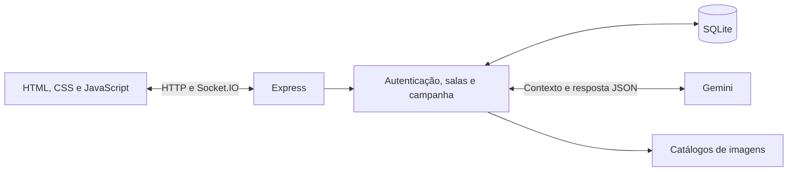

# Arquitetura do Entre Mundos

O Entre Mundos mantém uma campanha compartilhada por 2 a 8 jogadores. Cada sala possui um anfitrião, código de entrada, personagens e estado persistente. O anfitrião inicia a aventura quando todos os participantes possuem ficha e confirmam a prontidão.

## Componentes

| Camada | Arquivos | Responsabilidade |
| --- | --- | --- |
| Interface | `public/index.html`, `public/app.js`, `public/mesa.css` | Lobby, fichas, cenário, diário, ações e reconexão. |
| Apresentação do dado | `public/dado-mesa.js`, `Dado/` | Animação do D20 a partir da rolagem oficial. |
| Transporte | `src/http/aplicacao.js`, `src/http/tempoReal.js` | Rotas HTTP, eventos Socket.IO, autenticação e respostas públicas. |
| Serviços | `src/services/` | Criação de salas, seleção de imagens, narrativa e aplicação das regras. |
| Persistência | `src/repositorios/`, `database/` | Transações SQLite, revisões da campanha e migrações. |
| Regras e prompts | `src/rules/`, `src/prompts/` | Contratos de dados, limites mecânicos e instruções para a IA. |

## Ciclo da partida

1. O anfitrião informa título, história e tom. O servidor seleciona uma das cinco bases e solicita à IA a adaptação da abertura, dos NPCs e dos locais. Em caso de falha, a base local preserva a possibilidade de criar a sala.
2. Os jogadores escolhem classe, origem, habilidades e retrato. Os atributos derivam da classe e são validados no servidor. A ficha recebe inventário inicial, vida e energia.
3. O cliente envia a ação com o turno esperado. O servidor valida a participação na sala e serializa as operações da campanha.
4. A ação e seus resultados mecânicos são persistidos como cena pendente. O contexto enviado ao Mestre inclui autor, local, fichas, objetivos, memória e resultado oficial.
5. A narração chega progressivamente por Socket.IO durante a geração. A resposta JSON completa é validada antes de atualizar diário, objetivos e estado da campanha. As três escolhas sugeridas são produzidas na mesma consulta e persistidas com a cena.

O servidor controla dados, vida, energia, habilidades, inventário e deslocamentos. A bandeja do navegador representa o resultado recebido. O identificador `acao_id` permite reconhecer o reenvio da mesma ação. A revisão da campanha impede que uma atualização antiga substitua uma versão mais recente.

## Imagens

O catálogo contém 60 retratos e 30 cenários pré-gerados. Cada entrada registra identificação, descrição e classificação temática. A sugestão de retrato usa a descrição visual e a classe para selecionar candidatos para a IA, com alternativa local quando a consulta falha. A URL escolhida integra a ficha.

A imagem de cada ambiente é selecionada pelo tema, tipo, nome e descrição do local. O SQLite preserva a escolha para visitas futuras. O snapshot transmitido aos jogadores inclui a URL do cenário atual. Os arquivos públicos ficam em `public/avatares/`.

## Configuração de execução

O projeto requer Node.js 24 ou superior. `npm install` instala as dependências e `npm start` executa `src/servidor.js`. O SQLite é criado e migrado na inicialização. O endereço padrão é `http://127.0.0.1:3000`, acessível por navegadores no computador do servidor.

| Variável | Uso |
| --- | --- |
| `PORT` | Porta HTTP, com padrão 3000. |
| `DATABASE_PATH` | Arquivo SQLite, com padrão `database/rpg.db`. |
| `OPENROUTER_API_KEY` | Credencial do OpenRouter. Quando válida, seleciona esse provedor. |
| `GEMINI_API_KEY` | Credencial do Google AI Studio, usada pelo SDK `@google/genai` quando a chave do OpenRouter está ausente. |
| `GEMINI_MODEL` | Identificador do modelo no provedor selecionado. |
| `MASTER_MAX_TOKENS` | Limite de saída da narração de uma cena. |

As opções de provedor estão em `.env.example`. As credenciais são lidas do `.env` pelo servidor. As sessões usam cookies `HttpOnly`, senhas bcrypt e tokens armazenados por hash no banco. Tanto as rotas privadas quanto os eventos Socket.IO verificam a identidade e o acesso à sala.
