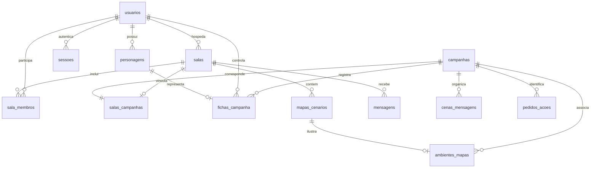

# Modelo de dados

O banco utiliza SQLite com chaves estrangeiras habilitadas. O esquema é definido em `database/schema.sql`. As migrações em `database/migrations/` são executadas uma vez e registradas em `migracoes`.

| Tabela | Identificação e conteúdo |
| --- | --- |
| `usuarios` | ID, nome de usuário e e-mail únicos, hash da senha. |
| `sessoes` | Hash do token, usuário e expiração. |
| `personagens` | Dono, classe, atributos, vida, inventário e URL do avatar. |
| `salas` | Anfitrião, nome, tema, código único, etapa e revisão da preparação. |
| `sala_membros` | Chave composta por sala e usuário, com prontidão. |
| `sala_jogadores` | Vínculo entre sala e personagem. |
| `campanhas` | ID, dono, mundo e estado em JSON, revisão e datas. |
| `salas_campanhas` | Ligação exclusiva entre sala e campanha. |
| `fichas_campanha` | Campanha, usuário, personagem e identificador do participante. |
| `mapas_cenarios` | Sala, nome, descrição, URL da imagem e indicação de mapa atual. |
| `ambientes_mapas` | Correspondência entre ID do ambiente na campanha e mapa no banco. |
| `mensagens` | Sala, autoria, tipo, conteúdo e data da ação ou narração. |
| `cenas_mensagens` | Associa cada cena a uma mensagem de ação e uma de narração. |
| `pedidos_acoes` | Campanha, identificador da ação, autor, turno e texto, para reconhecer reenvios. |

`campanhas.mundo_json` preserva o estado completo, incluindo energia, efeitos, memória, objetivos e cena pendente. A atualização da campanha sincroniza fichas, mapas e mensagens na mesma transação. O campo `revisao` é conferido antes da escrita. A chave composta de `cenas_mensagens` impede publicar novamente uma cena concluída.
